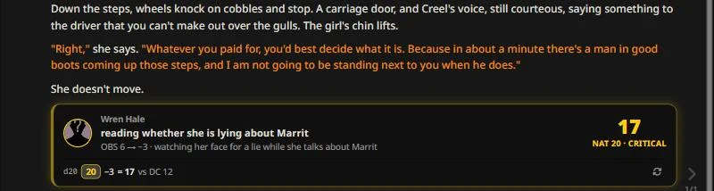
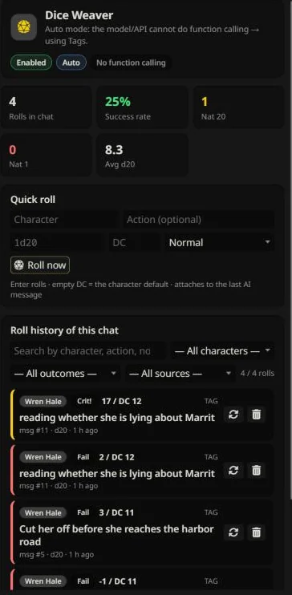

# Dice Weaver — Dice xúc xắc do AI kích hoạt cho SillyTavern

**AI khai hành động. Xúc xắc quyết định kết quả. Bạn nhìn thấy tất cả.**

[🌐 English](README.md) | [🇻🇳 Tiếng Việt](README.vi.md) · [📖 Tài liệu đầy đủ (VI)](USER_GUIDE.vi.md) · [📖 Full Documentation (EN)](USER_GUIDE.md)

---

## Đây là gì?

**Dice Weaver** cho phép nhân vật AI thực hiện các hành động rủi ro và phân định bằng dice d20 **thật** — do extension roll, không phải do model tự bịa. AI tường thuật hành động và khai *ý định*; extension roll d20 (theo stat, DC và luật crit của bạn), hiển thị kết quả thành thẻ kiểu game gọn gàng ngay trong chat, và lưu lại mọi lần roll để tra cứu trong bảng điều khiển.

Bạn chơi truyện. Extension giữ sự công bằng.

## Vì sao bạn cần nó

| Không có | Có Dice Weaver |
| --- | --- |
| AI tự tuyên bố "bạn thành công" theo ý muốn | Kết quả mơ hồ do dice thật quyết định — `crypto.getRandomValues`, không lệch xác suất |
| Tỷ lệ thành công nằm trong tưởng tượng của model | DC, modifier theo stat, luật crit 20/1 — đều cấu hình được |
| Lịch sử chat quên sạch mọi lần kiểm tra | Mỗi roll được lưu kèm tham số đầu vào, roll lại được từ bảng điều khiển |
| "Roll dice giùm tôi" làm đứt mạch truyện | AI kết thúc lượt bằng một dòng ý định; thẻ kết quả xuất hiện ngay tại chỗ |

## Nó làm được gì

- **Hai đường kích hoạt** — AI kết thúc reply bằng tag `<roll>`, hoặc gọi tool ẩn `roll_dice` khi model hỗ trợ function calling. Chế độ Auto tự chọn và tự fallback.
- **Dice thật, luật thật** — công thức stat → modifier (mặc định `round(({stat}-50)/15)`), DC (số hoặc thang tên `easy/normal/hard/extreme`), advantage/disadvantage cộng xúc xắc phạt (`advp`/`disp`), crit natural 20 / thất bại natural 1, công thức nhiều nhóm như `1d20+3`, `2d6+1d4` và roll sát thương (`kind="damage"`). Xúc xắc phạt và roll sát thương đến từ tag `<roll>` (xúc xắc phạt còn dùng được qua `/roll`, Roll nhanh và API) — tool `roll_dice` chỉ có check `adv`/`dis` thường.
- **Thẻ kết quả kiểu game** — avatar, hành động, tổng cỡ lớn kèm nhãn kết quả rõ ràng (*Thành công / Thất bại / Nat 20 · Chí mạng / Nat 1 · Thảm bại / Sát thương*) và dải hiện từng viên xúc xắc (viên bị loại do lợi thế/bất lợi bị gạch ngang), modifier, DC — chèn vào tin nhắn, có nút roll lại và hoàn tác ngay trên thẻ. Kết quả roll không lọt vào prompt của model (marker tối giản `[dice:#id]`, không có số trong text); mặc định vài kết quả chưa xem được đưa vào AI (trừ roll qua tool — model đã nhận rồi; có thể tắt) như một dòng lệnh ngắn để nó tường thuật hậu quả.
- **Trigger bắt buộc** — gõ từ khoá của bạn, lượt trả lời kế tiếp của AI *bắt buộc* roll nếu tình huống xảy ra.
- **Bảng Roll Hub** — nút cạnh ô nhập tin với badge sống: form Roll nhanh (giống `/roll`), thống kê tỉ lệ thành công / Nat 20 / Nat 1 / trung bình d20, lịch sử roll lọc/tìm được — **bấm vào một roll để nhảy tới tin nhắn đó**, roll lại / hoàn tác / xoá từng lần, xoá hàng loạt, xuất JSON.
- **Quy tắc theo nhân vật** — công thức, DC, trigger và công tắc bật/tắt riêng cho từng card nhân vật, key theo card.
- **An toàn với swipe** — mỗi vị trí swipe giữ roll riêng; qua lại swipe không mất/không nhân bản thẻ.
- **UI tiếng Việt & English** — mặc định English; chọn Tiếng Việt (hoặc *Auto* = theo SillyTavern) trong settings.

<em>Roll Hub: tung nhanh, thống kê và lịch sử tung có tìm kiếm.</em>

## Triết lý thiết kế

- **AI không bao giờ tự roll.** Model chỉ khai *làm gì*; extension quyết định *làm tốt tới đâu*. Dữ liệu kết quả nằm trong payload + UI; model nhiều nhất chỉ thấy một dòng ngắn báo kết quả (bật mặc định, có thể tắt) để tường thuật, không bao giờ thấy số dice để tự bịa.
- **Ý định, không phải lòng tin.** Tag hỏng, reply bị cắt, text giả dạng tool-call: được cứu hoặc bị chặn có giám sát; model không thể tự bịa kết quả.
- **Mọi thứ local và theo chat.** Roll nằm trong file lưu chat. Không có gì rời khỏi máy bạn.
- **Chạy với mọi model.** Tag protocol không cần gì đặc biệt; function calling được dùng tự động khi có.

## Tương thích

- SillyTavern **1.18.0+**
- Mọi nguồn chat completion; tool calling tự động được nhận diện (tuỳ chọn, có thì đẹp hơn)
- Chat đơn và group chat; độc lập — không cần extension nào khác

## Cài đặt

**Yêu cầu:** SillyTavern **1.18.0+**.

**Cách 1 — cài thẳng từ SillyTavern (khuyên dùng):**

1. Mở panel **Extensions** (icon puzzle) → bấm **Install extension**.
2. Dán Git URL: `https://github.com/khangdh0202/SillyTavern-DiceWeaver`
3. Chọn **Install just for me** (cho riêng user này) hoặc **Install for all users**.
4. Mở bất kỳ chat nào — nút **Dice Weaver** hiện phía trên ô nhập tin.

**Cách 2 — thủ công:**

Clone hoặc copy repo vào một trong hai thư mục extensions rồi reload SillyTavern (F5):

- Theo user: `data/<user-handle>/extensions/st-diceweaver`
- Dùng chung: `public/scripts/extensions/third-party/st-diceweaver`

**Nâng cấp:** panel **Extensions** → **Manage extensions** → *Update* (hoặc `git pull` trong thư mục), rồi reload trang (F5). Dữ liệu roll nằm trong file lưu chat — update không bao giờ đụng vào.

**Không cần cấu hình gì để bắt đầu.** Mặc định AI sẽ roll khi kết quả mơ hồ, dùng d20 + công thức stat. Mở ⚙ Extensions → Dice Weaver để tinh chỉnh mode, công thức, DC và quy tắc từng nhân vật (xem guide).

**Xử lý sự cố:** nút không hiện — xem console trình duyệt (F12) có log Dice Weaver không, kiểm tra extension có trong danh sách và đang bật ở panel Extensions (**Manage extensions**), rồi reload bằng F5. Tên thư mục không quan trọng — cài từ Git URL sẽ tạo `SillyTavern-DiceWeaver`, bản copy thủ công có thể tên `st-diceweaver`; cả hai đều chạy.

## Thuộc một bộ extension

Chạy độc lập được, và kết hợp được với các extension cùng tác giả:

| Extension | Thêm gì |
|---|---|
| [Storyline](https://github.com/khangdh0202/SillyTavern-Storyline) | Chế độ chat người kể chuyện: bạn nhập vai nhân vật chính, AI kể cả thế giới |
| [Character State](https://github.com/khangdh0202/SillyTavern-CharacterStats) | Bảng nhân vật lâu dài, AI tự cập nhật |
| [Memory Weaver](https://github.com/khangdh0202/SillyTavern-MemoryWeaver) | Bộ nhớ truyện dài hạn |

## Tài liệu

📖 **[USER_GUIDE.vi.md](USER_GUIDE.vi.md)** — hướng dẫn đầy đủ tiếng Việt: mọi setting, Roll Hub, `/roll`, trigger, từng bước.
🌐 **[USER_GUIDE.md](USER_GUIDE.md)** — full manual in English.

## 🐞 Báo lỗi & hỗ trợ

Gặp lỗi hoặc có câu hỏi? Mở issue tại **[GitHub Issues](https://github.com/khangdh0202/SillyTavern-DiceWeaver/issues/new/choose)** và chọn *Bug report* hoặc *Question / idea* — form sẽ hỏi đủ thông tin cần thiết.

Một báo lỗi tốt gồm:

- phiên bản SillyTavern và phiên bản Dice Weaver (panel Extensions → Manage extensions)
- API / model bạn đang dùng
- các bước tái hiện: bạn đã làm gì, mong đợi gì, thực tế xảy ra gì
- lỗi trong console trình duyệt (F12 → Console) nếu có — copy các dòng màu đỏ
- ảnh chụp màn hình khi hiển thị sai

Hãy xoá nội dung truyện riêng tư và API key trước khi đăng — issue là công khai.

## ❤️ Ủng hộ

Nếu Dice Weaver khiến game của bạn hay hơn, hãy cân nhắc ủng hộ:

hoặc bấm nút **💜 Sponsor** ở đầu trang repo (bật qua `.github/FUNDING.yml`).

## License

Phát hành theo [GNU General Public License v3.0 (GPL-3.0)](LICENSE) — tự do dùng, sửa, phân phối; mọi bản fork/phân phối phải mở source theo cùng license. © 2026 kdturtle.
